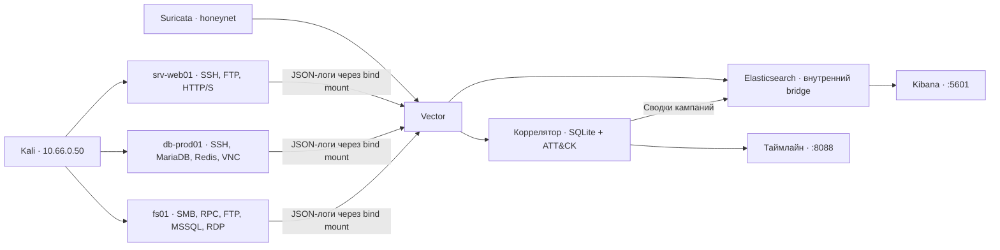

# Mirage — учебная honeynet в VirtualBox

Изолированный стенд для изучения атак и защитной телеметрии. Одна VM изображает три сервера корпоративной сети, Kali выполняет учебный сценарий, а ловушки записывают обращения, попытки входа и команды. Elasticsearch хранит события, Kibana показывает сводную картину, коррелятор строит таймлайн и отмечает предполагаемые техники MITRE ATT&CK.

## Возможности

- SSH-ловушки Cowrie с эмулируемой файловой системой и записями сессий.
- FTP, MariaDB, Redis, VNC, MSSQL и RDP на OpenCanary; SMB и RPC на Dionaea.
- Веб-портал на FastAPI за nginx с учебными утечками, HTTP/S и распознаванием маркеров сканеров.
- Уникальные honeytokens для отслеживания использования найденных паролей и deploy-ключа.
- Suricata, общая схема событий в Vector и дашборд Kibana с панелями IDS, JA3 и сканеров.
- Коррелятор с алертами, графом переходов между хостами и матрицей ATT&CK: 24 техники в каталоге, 17 правил для команд.
- Автоматическая настройка через Vagrant и Ansible, учебный сценарий и проверки в GitHub Actions.

## Дашборды

### Kibana: обзор событий

Дашборд **Mirage — Attack Overview** объединяет события всех источников: распределение по хостам, временную последовательность, IP источников, попытки входа, сервисы и команды SSH. Дополнительные панели показывают сигнатуры Suricata, TLS JA3 и имена инструментов, определённые по User-Agent.


Снимок сделан в Elasticsearch и Kibana 8.15.3 с шаблонами этого репозитория. Для демонстрации панелей загружена репрезентативная учебная кампания: 388 событий с источником `10.66.0.50`. Это демонстрационный набор данных; снимок не является результатом повторного сквозного прогона последней версии стенда.

### Коррелятор: алерты и связи между хостами

Вверху страницы собраны алерты об использовании honeytokens. Граф показывает связи источника с хостами, а матрица ATT&CK выделяет техники, для которых найдены соответствующие события. Служебные источники вне `10.66.0.0/24` исключаются из кампаний.


### Таймлайн кампании

Для каждой кампании можно раскрыть последовательность событий: время, хост, действие, команду и предполагаемую технику ATT&CK. Это позволяет сопоставить вход в SSH, чтение приманки и последующее применение найденных учётных данных.


## Архитектура

```text
Windows host
 ├─ host-only 192.168.56.0/24  → управление: SSH, Kibana :5601, коррелятор :8088
 └─ internal "honeynet" 10.66.0.0/24
      ├─ Kali    10.66.0.50
      └─ mirage  10.66.0.10 srv-web01
                 10.66.0.20 db-prod01
                 10.66.0.30 fs01
```

Три адреса серверов — IP-алиасы одной VM. Отдельные Docker bridges разделяют ловушки. NAT у mirage используется для установки пакетов и загрузки образов; исходящие соединения контейнеров блокируются. Перед атаками NAT у Kali отключается режимом `lab-mode`.



Подробное описание границ доверия — в [docs/architecture.md](docs/architecture.md).

### Сервисы-приманки

| Хост | Образ сервера | Сервисы | Реализация |
|---|---|---|---|
| `10.66.0.10` — srv-web01 | Debian 12, веб-сервер | SSH 22, FTP 21, HTTP 80, HTTPS 443 | Cowrie, OpenCanary, FastAPI, nginx |
| `10.66.0.20` — db-prod01 | Debian 12, сервер БД | SSH 22, MariaDB 3306, Redis 6379, VNC 5900 | Cowrie, OpenCanary |
| `10.66.0.30` — fs01 | Windows Server 2008 R2 | FTP 21, RPC 135, SMB 445, MSSQL 1433, RDP 3389 | Dionaea, OpenCanary |

На web01 предусмотрены слабые учебные пароли. На db-prod01 вход разрешён по заданному паролю backup и deploy-ключу из приманок. Все данные, ключи и учётные записи предназначены только для стенда.

## Запуск

Нужны VirtualBox 7.x, Vagrant 2.4+ и Kali VM. Конфигурация mirage выделяет 8 ГБ RAM и 4 vCPU. Имя Kali по умолчанию: `kali-linux-2025.4-virtualbox-amd64`.

Сначала штатно выключить Kali, затем выполнить на Windows-хосте из каталога проекта:

```powershell
.\scripts\vbox-kali-attach.ps1
vagrant up
```

Внутри Kali настроить второй сетевой интерфейс:

```bash
sudo ./attacker/setup-net.sh  # eth1 → 10.66.0.50/24, без шлюза
```

После изменений в конфигурации:

```powershell
vagrant provision --provision-with ansible
```

### Доступ к аналитике

| Интерфейс | Адрес с Windows-хоста | Вход |
|---|---|---|
| Kibana | `http://192.168.56.10:5601` | `elastic` и `ELASTIC_PASSWORD` |
| Коррелятор | `http://192.168.56.10:8088` | `analyst` и `CORRELATOR_KEY` |
| Администрирование VM | `vagrant ssh` | SSH-ключ Vagrant |

Секреты создаёт `scripts/generate-secrets.py` в `/opt/mirage/stack/.env` с правами `0600`. Файл доступен администратору внутри VM и исключён из Git. Elasticsearch не публикует порт на VM; доступ к нему требует аутентификации.

### Изолированный режим Kali

```powershell
.\scripts\lab-mode.ps1 on   # отключить NAT перед сценарием
.\scripts\lab-mode.ps1 off  # вернуть NAT после проверки
```

С включённым NAT Kali может достичь management-сети через Windows-хост. На стороне mirage такое соединение выглядит как обращение с адреса хоста `192.168.56.1`, поэтому для учебной атаки требуется `lab-mode on`.

### Автоматический запуск и проверка

```powershell
.\scripts\rebuild-and-verify.ps1
# Для уже поднятой VM:
.\scripts\rebuild-and-verify.ps1 -SkipVagrantUp
```

Скрипт поднимает стенд, подключает и запускает Kali, настраивает сеть, включает изоляцию, выполняет сценарий и проверяет кампанию. Kali должна быть выключена заранее: принудительное выключение не выполняется. При ошибке проверяемого этапа скрипт останавливается; после выполнения сценария NAT возвращается через `finally`.

Предварительная проверка VBS читает состояние Windows и останавливает запуск при несовместимой конфигурации или неопределённом результате. Настройки защиты Windows скрипт не меняет.

## Учебный сценарий

`attacker/run-all.sh` выполняет разведку, веб-пробы, подбор пароля SSH, discovery-команды, чтение приманок, вход на db-prod01 по паролю и ключу, эмуляцию закрепления и эксфильтрации, затем обращения к SMB.

```powershell
.\scripts\lab-mode.ps1 on
try {
    .\scripts\kali-run.ps1 attacker\run-all.sh -Sudo
    vagrant ssh -c "sudo python3 /vagrant/tests/e2e/check_campaign.py"
} finally {
    .\scripts\lab-mode.ps1 off
}
```


| Шаг | Наблюдаемое действие | Предполагаемые техники |
|---|---|---|
| Разведка | Сканирование сервисов, сигнатуры IDS | T1046 |
| Веб-пробы | SQLi-паттерны и запросы к приманкам | T1190, T1552.001 |
| Подбор пароля и вход | Неудачные попытки, затем успешный вход | T1110, T1078 |
| Разведка на хосте | `hostname`, `uname`, `id`, `ps`, `ls` | T1082, T1083, T1057 |
| Поиск учётных данных | Чтение `.env` и `.bash_history` | T1552.001 |
| Переход на db-prod01 | Использование пароля backup и deploy-ключа | T1021.004, T1078 |
| Разведка сети и аккаунтов | `ip`, `netstat`, `ss`, `getent`, `last` | T1016, T1049, T1033, T1087 |
| Эмуляция закрепления | `crontab`, запись в `authorized_keys` | T1053.003, T1098.004 |
| Эмуляция сокрытия следов | `sudo`, `iptables -F`, `history -c` | T1548.003, T1562.004, T1070.003 |
| Перенос и эксфильтрация | Команды `wget` и `curl -T` внутри эмуляции | T1105, T1041 |
| SMB | Обращение к файловому серверу | T1021.002 |

### Honeytokens и credential reuse

Генератор `honeytokens/generate.py` создаёт токены T1–T4 и размещает их в эмулируемой файловой системе и веб-приманках. История Git содержит учебный deploy-ключ. Реестр находится в `/opt/mirage/stack/seeds/registry.yml`.

Уникальные значения связывают последующее применение секрета с местом его размещения. В ранее проверенном сценарии были зарегистрированы два алерта `credential-reuse`: T1 из истории команд и T4 из истории Git, оба на db-prod01. Вместе с успешным входом это показывает переход между эмулируемыми хостами в рамках сценария.

## Снимки проверок сервисов

Терминальные изображения ниже отрисованы из сохранённого вывода команд. Скриншоты Kibana и коррелятора выше — снимки веб-интерфейсов.

### Разведка

Nmap видит разные наборы сервисов на трёх адресах. Снимок относится к раннему этапу настройки, до добавления HTTP/S.


### Доступ по SSH

Перебор на web01 находит предусмотренный учебный пароль. Cowrie возвращает имя хоста, пользователя и сведения об ОС из эмуляции.


Тот же пароль на db-prod01 отвергается:


### Остальные сервисы и журналирование

SMB перечисляет учебные шары; Redis, MariaDB и VNC отвечают своими протокольными баннерами.


Ловушки сохраняют адрес источника `10.66.0.50`. Настройка Docker `userland-proxy: false` позволяет не подменять его адресом прокси.


## Изоляция

- Входящий трафик honeynet достигает опубликованных портов ловушек; административный SSH слушает NAT и management-адрес.
- nftables блокирует новые исходящие соединения контейнеров в интернет и management-сеть.
- Ловушки разделены Docker bridges. nginx и веб-приложение используют общий bridge для связи прокси с backend.
- Контейнеры ловушек используют read-only корень, ограничения ресурсов и минимально необходимые capabilities. Исключения для конкретных образов указаны в Compose.
- Записанные файлы и журналы находятся в `/srv/mirage/data` на mount с `noexec,nosuid,nodev`; скачанные файлы автоматически не запускаются.

`scripts/check-isolation.sh` проверяет доступ к интернету, соседней ловушке и management-адресу. Положительный контроль подтверждает, что проба умеет обнаруживать открытый порт.


## Проверки и ограничения

На 16 октября 2026 года локально прошли **12 юнит-тестов**; синтаксис `rebuild-and-verify.ps1` проверен. GitHub Actions запускает тесты, проверяет ATT&CK-правила, генерацию saved objects Kibana и синтаксис shell-скриптов.

```powershell
python -m pytest stack/apps/tests -q
```

Последний ранее выполненный сквозной прогон дал кампанию с 11 техниками и двумя алертами `credential-reuse`. Проверка `tests/e2e/check_campaign.py` требует минимум восемь техник, алерт повторного использования секрета и сохранённую сводку в Elasticsearch. Полная пересборка и повторный сквозной прогон расширенного сценария после последних изменений ещё не подтверждены.

При интерпретации результатов учитывать:

- Кампании группируются по IP и получасовому окну. Общий NAT может объединить источники, а смена адреса или граница окна — разделить сценарий.
- Метка ATT&CK отражает гипотезу по событию. Обращение к SMB не доказывает успешного входа, команда в Cowrie не означает её выполнение на настоящем хосте.
- User-Agent можно подделать: имя инструмента обозначает наблюдаемый маркер.
- Коррелятор фильтрует источники по honeynet; Kibana сохраняет более широкий набор событий. Для разбора конкретного источника использовать `source.ip`.

### Особенности конфигурации

Telnet в Cowrie выключен: Nmap распознаёт его как honeypot. Конфиги Dionaea сохраняются в ASCII из-за обнаруженного сбоя загрузчика. OpenCanary поддерживает ограниченный набор баннеров MySQL и версий MSSQL; выбранные значения согласованы с образами серверов. Для pid-файла OpenCanary в read-only контейнере выделен tmpfs `/run`.

## Обновление скриншотов

С Windows-хоста с доступом к management-сети:

```powershell
$env:ELASTIC_PASSWORD="..."
$env:CORRELATOR_KEY="..."
python scripts\shots.py
# Отдельные виды:
python scripts\shots.py correlator timeline
```

Значения берутся из `/opt/mirage/stack/.env`. Пароли не следует добавлять в репозиторий. Терминальные иллюстрации пересоздаются через `scripts/termshot.py` из сохранённого вывода команд.

## Структура проекта

| Путь | Назначение |
|---|---|
| `Vagrantfile` | Ресурсы VM и три сетевых интерфейса |
| `provision/ansible/` | Установка и настройка инфраструктуры, IDS и сервисов |
| `stack/docker-compose.yml` | Ловушки, прокси, сборщик, хранилище и аналитика |
| `stack/traps/` | Конфигурация Cowrie, OpenCanary, Dionaea и nginx |
| `stack/apps/` | Веб-ловушка, коррелятор, ATT&CK-правила и юнит-тесты |
| `stack/elastic/` | Шаблоны индексов, saved objects Kibana и настройка доступа |
| `honeytokens/` | Генерация учебных токенов и файловых систем |
| `scripts/` | Управление VM, изоляция, проверки и скриншоты |
| `attacker/` | Сценарии для Kali и учебные словари |
| `tests/e2e/` | Сквозная проверка кампании |
| `.github/workflows/ci.yml` | Автоматические проверки |
| `docs/` | Архитектура и иллюстрации |
