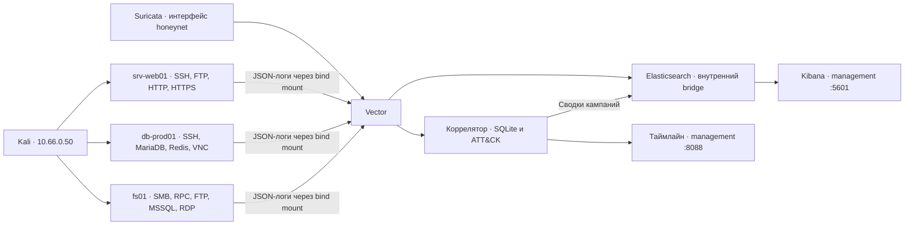

# Mirage: схема и границы доверия

## Сеть

У mirage три интерфейса: NAT для установки пакетов, host-only для
управления, internal `honeynet` для ловушек. У Kali NAT отключается
перед сценарием. IP-алиасы изображают хосты, но не являются отдельными VM.

Ловушки разделены Docker bridges. Только nginx и веб-приложение разделяют
один bridge: прокси передаёт запросы в backend и заменяет X-Forwarded-For
реальным адресом клиента. Уловленные файлы не исполняются.

## Данные

Настоящие административные секреты создаются в `/opt/mirage/stack/.env`,
с правами 0600. Synthetic seeds находятся в соседнем каталоге `seeds` и
публикуются только специально предусмотренными маршрутами ловушки.
Не использовать эти учётные данные на настоящих сервисах.

Vector читает логи, а не принимает соединения от ловушек. Потеря связи
с Elasticsearch или коррелятором приводит к буферизации на диске.
Коррелятор отбрасывает точные повторы доставки по SHA-256 события.
Пароли попыток входа остаются в защищённом Elastic, но удаляются из
локального хранилища таймлайна после проверки токенов.

## Интерпретация

Кампании группируются по IP и получасовому интервалу. Общий NAT может
объединить несколько атакующих, а смена IP или граница интервала —
разделить один сценарий. ATT&CK обозначает гипотезу о технике по
наблюдаемому действию. Запись SMB не доказывает успешный lateral movement;
попытка `curl -T` в Cowrie не доказывает отправку настоящих данных.

Имя сканера определяется по User-Agent: этот заголовок можно подделать.
Из-за этого дашборд показывает наблюдаемый маркер, а не гарантированную
идентификацию инструмента.
